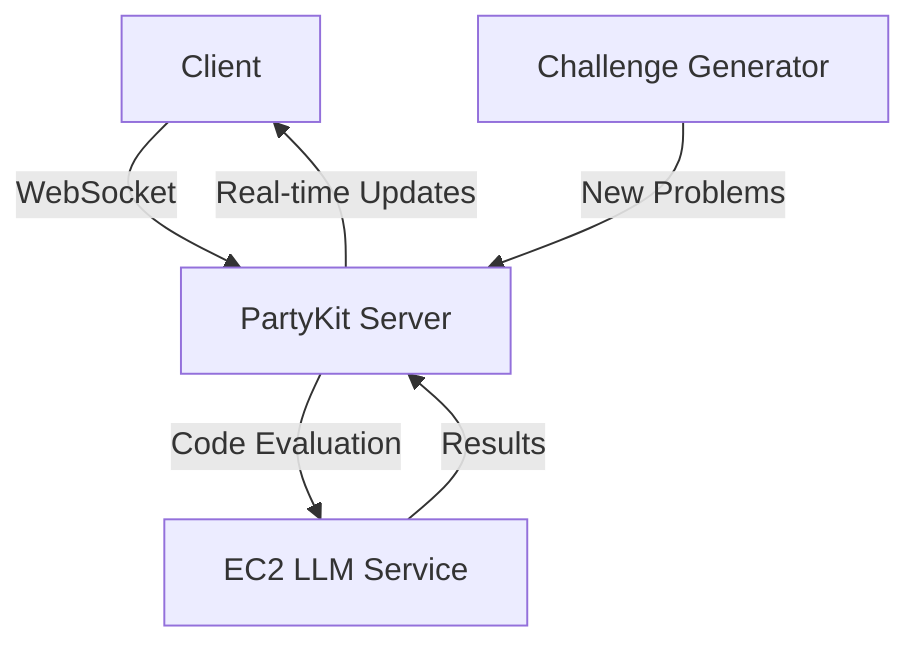

## Code Clash

**Growth Through Gamified Learning**

---

### Overview

**Code Clash** is an innovative platform that transforms coding education into an engaging, multiplayer experience. By combining real-time coding battles, instant feedback, and interactive visualization, Code Clash fosters both individual and community growth while making learning to code as fun as playing your favorite game.

---

## Features

- **Real-time Multiplayer Coding Battles:** Compete with friends or peers in live coding challenges, leveraging a real-time infrastructure for seamless interaction.
- **AI-Powered Dynamic Feedback:** Receive instant, personalized feedback from an integrated large language model (LLM) for every code submission.
- **Instant Code Evaluation:** Solutions are automatically evaluated, with results and peer solutions displayed for collaborative learning.
- **Skill-Based Matchmaking:** Players are matched based on skill level, ensuring balanced and fair competition.
- **Interactive Code Visualization:** Beginners can see their code in action, making abstract concepts tangible.
- **Progressive Challenge System:** Challenges scale from beginner to advanced, supporting ongoing personal growth.
- **Community and Mentorship:** Built-in peer learning, mentorship, and community features.
- **Accessibility and Scalability:** Designed to break down barriers to coding education and support a rapidly growing user base.

---

## Tech Stack

| Technology         | Purpose                                     |
|--------------------|---------------------------------------------|
| Next.js & TypeScript | Frontend framework and type safety         |
| Tailwind CSS       | Utility-first, responsive UI styling        |
| Framer Motion      | Smooth, interactive UI animations           |
| PartyKit           | Real-time multiplayer infrastructure        |
| Amazon EC2         | Self-hosted LLM for code analysis           |
| WebSocket Protocol | Sub-100ms latency for real-time interaction |
| MongoDB Atlas      | Cloud-based database for user data          |

---

## System Architecture

- **Client:** Browser-based interface for users.
- **PartyKit Server:** Manages real-time multiplayer sessions, synchronizes state, and routes code submissions.
- **EC2 LLM Service:** Evaluates code, provides feedback, and returns results.
- **Challenge Generator:** Supplies new, dynamically generated coding problems.

---

## Key Achievements

- Fully functional multiplayer system with real-time synchronization.
- Sub-100ms latency for code battles via optimized WebSocket communication.
- AI-driven instant code evaluation and feedback.
- Dynamic challenge generation and matchmaking.
- Responsive, animated UI/UX for all devices.
- Secure code execution environment.

---

## Development Journey

- First-time implementation of TypeScript and real-time multiplayer systems.
- Rapid learning and deployment of PartyKit for real-time infrastructure.
- Mastery of WebSocket optimization for minimal latency.
- Custom LLM prompt engineering for code evaluation.
- Responsive UI/UX with Framer Motion.
- Integration of EC2 cloud storage and MongoDB Atlas for scalability.

---

## Design & User Experience

- Clean, distraction-free coding interface.
- Responsive design for desktop and mobile.
- Engaging, game-like animations and progress indicators.
- Inclusive design for all skill levels.

---

## Future Roadmap

- WebAssembly integration for browser-based code compilation.
- Advanced AI-driven curriculum adaptation.
- Enhanced analytics dashboard for user progress.
- Global tournament infrastructure.
- Native mobile applications.

---

## Getting Started

1. **Clone the Repository:**  
   `git clone https://github.com/your-org/code-clash.git`

2. **Install Dependencies:**  
   `npm install`

3. **Configure Environment:**  
   - Set up environment variables for EC2, MongoDB, and PartyKit endpoints.

4. **Run Locally:**  
   `npm run dev`

5. **Access the App:**  
   Open `http://localhost:3000` in your browser.

---

## Contributing

We welcome contributions! Please submit issues and pull requests to help us expand and improve Code Clash.

---

## License

MIT License

---

Built with determination in 24 hours by a team passionate about democratizing coding education.
